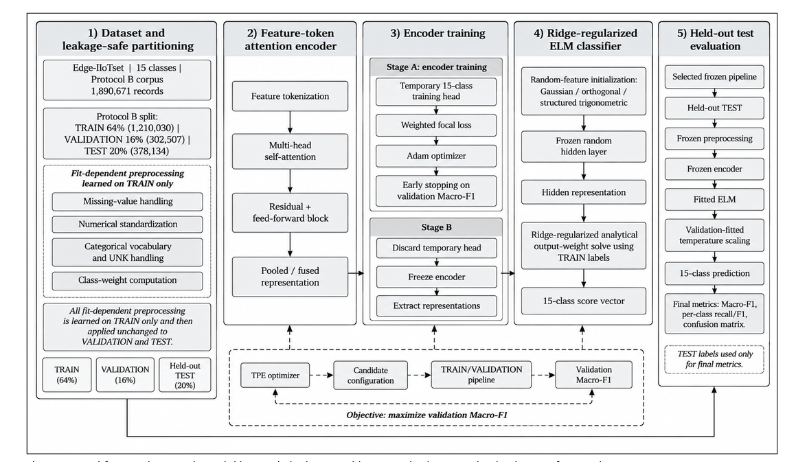

# Feature-token attention + ridge ELM for Industrial IoT intrusion detection

[](https://github.com/drmohammedadnan110-ai/iiot-feature-token-elm/actions/workflows/tests.yml)
[Project page](https://drmohammedadnan110-ai.github.io/iiot-feature-token-elm/) · [Architecture](src/iiot_ids/model.py) · [Training](src/iiot_ids/engine.py) · [Dataset guide](docs/datasets.md) · [Experiments](docs/experiments.md)

Research code accompanying the supplied manuscript **“Industrial IoT Intrusion Detection Using Feature-Token Attention and a Ridge-Regularized Extreme Learning Machine.”**

The implementation trains a feature-token attention encoder with a temporary supervised head, freezes the encoder, fits a ridge-regularized extreme learning machine (ELM), and calibrates its scores on validation data. Training, validation, hyperparameter selection, and held-out testing have separate responsibilities.

**Status:** executable reference implementation with regression tests and an executed synthetic example. The original data snapshots, split memberships, final hyperparameters, and trained checkpoints were not supplied. The paper's real-data performance has **not** been reproduced here. See the [implementation choices](docs/method.md) and [paper audit](docs/paper_audit.md) before interpreting results.



## What is included

| Component | Code |
|---|---|
| Explicit feature schema, TRAIN-only imputation, scaling and vocabulary | [preprocessing.py](src/iiot_ids/preprocessing.py) |
| Source hashes, duplicate/group linkage, 64/16/20 reference split, leakage checks | [data.py](src/iiot_ids/data.py) |
| Feature tokenizer, self-attention, residual blocks, focal loss | [model.py](src/iiot_ids/model.py) |
| Gaussian, block-orthogonal and structured trigonometric ELM; streamed ridge solve | [elm.py](src/iiot_ids/elm.py) |
| Adam training, validation checkpoint selection, frozen ELM fitting, prediction and testing | [engine.py](src/iiot_ids/engine.py) |
| 100-trial TPE search domain from manuscript Table 5 | [search.py](src/iiot_ids/search.py) |
| Fixed-class metrics, calibration, ROC/PR and binary collapse | [metrics.py](src/iiot_ids/metrics.py) |
| Paired seed t-tests, t intervals, Cohen's dz, Holm correction, grouped bootstrap | [statistics.py](src/iiot_ids/statistics.py) |
| 13 selectable classical/MLP/boosting baseline families | [baselines.py](src/iiot_ids/baselines.py) |
| Dataset-native retraining, explicit source-only transfer, unknown-attack evaluation and timing | [generalization.py](src/iiot_ids/generalization.py) |
| Confusion matrix, reliability, ROC/PR and learning-curve figures | [plots.py](src/iiot_ids/plots.py) |
| Matched seed and ablation runner, paper table extraction, notebook | [scripts](scripts/) · [notebooks](notebooks/) |

The selected classical baselines are logistic regression, Gaussian naïve Bayes, k-NN, SVM, decision tree, random forest, extra trees, AdaBoost, histogram gradient boosting, MLP, and optional XGBoost/LightGBM/CatBoost. They use documented reference settings. The manuscript's CNN/LSTM/GRU/BiLSTM, TabNet, FT-Transformer, SAINT and TabM comparisons are **not implemented or claimed reproduced**; their exact configurations were not supplied.

## Install and try the complete workflow

Python 3.10 or newer is required. CPU works for the demonstration; choose a compatible PyTorch CUDA installation for larger experiments.

```bash
python -m venv .venv
# Linux/macOS: source .venv/bin/activate
# PowerShell: .venv\Scripts\Activate.ps1
python -m pip install -e ".[dev]"
python -m pytest -q
python -m iiot_ids.cli demo --out runs/demo --seeds 7
```

`iiot` is also installed as a command. Use `iiot --help`. Each run requires a fresh output directory to protect previous experiments. The demo creates synthetic observations, prepares partitions, trains the complete encoder + ELM, calibrates, tests, trains a logistic baseline, and produces prediction files and figures. These observations are Gaussian toy data bearing class names only; they are **not network traffic**.

For the executed five-seed demonstration, inspect [scope and provenance](results/executed/synthetic_demo/scope.json), [scores](results/executed/synthetic_demo/seed_scores.csv), [paired statistics](results/executed/synthetic_demo/paired_seed_statistics.json), and [figures](results/executed/synthetic_demo/figures/). Re-run with `--seeds 7 13 21 42 99`. This is integration evidence, not evidence for IDS accuracy.

## Run with real data

Obtain the provider files, document the release and terms, inspect the actual CSV headers, and define the prediction target and grouping policy. See the [dataset guide](docs/datasets.md).

```bash
iiot schema --csv data/raw/edge.csv --label Attack_type --out configs/edge.reviewed.json
# Review/edit that draft before proceeding: ordered predictors, full label taxonomy,
# excluded labels/identifiers, grouping columns, and category aliases.
iiot prepare --csv data/raw/edge.csv --schema configs/edge.reviewed.json --out data/prepared/edge
iiot train --config configs/reference.yaml --out runs/reference_seed7
iiot test --bundle runs/reference_seed7 --data data/prepared/edge --out runs/reference_seed7_test
iiot figures --predictions runs/reference_seed7_test/predictions.csv --schema data/prepared/edge/schema.json --history runs/reference_seed7/history.csv --out runs/reference_seed7_figures
iiot predict --bundle runs/reference_seed7 --csv data/new_observations.csv --out runs/new_predictions.csv
```

`Attack_type` is an example header; use the exact field in your downloaded file. The schema draft samples the first 10,000 rows and cannot establish the full taxonomy or safe predictors. `schema.example.json` is illustrative, not the missing manuscript feature list. The split seed defaults to 42; this does not identify the manuscript's original membership. Grouped splits may differ from exact nominal proportions. Every active class must occur in all three partitions.

To tune on TRAIN/VALIDATION, run `iiot search --config configs/reference.yaml --out runs/tpe --trials 100`. Its `selected.json` identifies the selected frozen bundle. Evaluate that bundle on TEST only after selection. The same validation partition is used for early stopping, search, and calibration as described in the manuscript; this does not provide an unbiased validation performance estimate.

## Datasets

| Dataset | Official provider |
|---|---|
| Edge-IIoTset | [IEEE DataPort DOI: 10.21227/mbc1-1h68](https://doi.org/10.21227/mbc1-1h68) |
| ToN-IoT | [UNSW project page](https://research.unsw.edu.au/projects/toniot-datasets) |
| X-IIoTID | [Authors' repository](https://github.com/Alhawawreh/X-IIoTID) |
| CICIoT2023 | [UNB Canadian Institute for Cybersecurity](https://www.unb.ca/cic/datasets/iotdataset-2023.html) |

Provider pages, access limitations, task definitions and necessary manifests are documented in [datasets.md](docs/datasets.md). Dataset files are not redistributed. Provider access may require authentication or registration; direct download availability was not confirmed for all sources.

## Paper details and figures

The supplied manuscript lists Md Ashiqul Islam, Kaniz Sultana Chy, Ariful Alam Mojumder, Mohammad Sazzad Hossain, Maria Kabtia, Samia Akter, Md Shahiduzzaman, and Mohammed Adnan. Its main task is 15-class Edge-IIoTset classification. It reports a 1,890,671-record corpus, a 64/16/20 split, and five-seed mean Macro-F1 **0.9456**. Those are **manuscript claims**, not measurements from this repository.

All 20 extracted tables are preserved under [results/reported](results/reported/); eight original embedded figures are preserved under [figures/paper](figures/paper/). The supplied architecture is displayed above. See [figure provenance](figures/README.md), [source provenance](results/reported/provenance.json), and the [paper audit](docs/paper_audit.md), which identifies missing reproduction details and arithmetic inconsistencies. Extracted tables preserve the source's values without silently correcting them.

## Reproducibility and limits

Numeric checkpoints use NPZ with `allow_pickle=False`; metadata and preprocessing use JSON. Bundles bind their feature schema, splits and model files to SHA-256 digests. These checks detect accidental mismatch and are not cryptographic authentication of a publisher. Run only configurations you have reviewed.

Raw CSV ingestion, duplicate grouping, and preprocessed arrays currently reside in memory. Only the ELM sufficient statistics are accumulated by batch. Budget RAM and disk before a 1.89-million-row, 100-trial run; trial bundles and validation predictions are retained. Real-data, full-budget HPO, GPU throughput, and production deployment were not executed here. This code is for offline research and does not establish an operational intrusion-detection guarantee.

The [MIT license](LICENSE) applies to original repository code. Supplied manuscript figures and dataset materials retain their authors' and providers' rights; see [THIRD_PARTY.md](THIRD_PARTY.md). [CITATION.cff](CITATION.cff) identifies this implementation separately from the unpublished manuscript.
